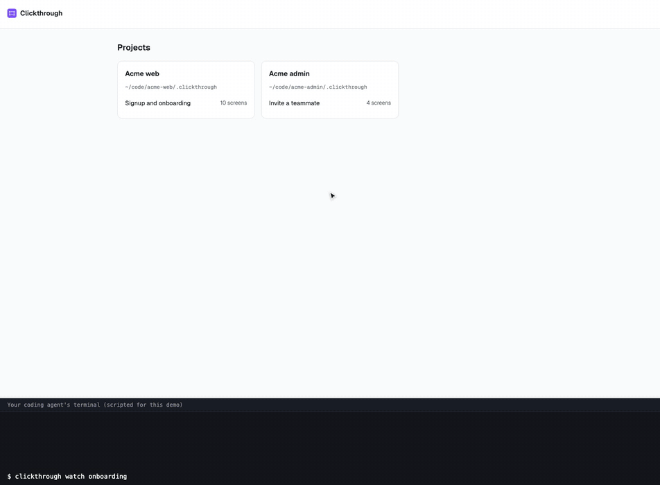

# Clickthrough

[](https://www.npmjs.com/package/clickthrough)
[](LICENSE)
[](package.json)

Review a product flow screen by screen, then hand the comments to your coding
agent.

An agent walks your app (signup, onboarding, checkout…) and captures every
screen with the position of each component. You open a local page, follow the
flow's branches in a tree, click any button, field or heading, and write what
should change. The agent reads your comments, changes the code, re-captures the
screens and replies on each thread. New versions show up live, with the
previous ones a click away.



The recording uses a made-up product; the scripts that produce it are in
[site/demo](site/demo).

- **Branches, not a list.** A flow is a graph: "Sign up with Google" and "Email
  and password" are separate branches, and so is each integration you can
  connect. Where branches meet again, the tree says so instead of repeating
  screens.
- **Comment or navigate.** In Comment mode a click on a component starts a
  comment. In Navigate mode (press `N`) the screens behave like the app: click
  "Sign up with Google" and you are on the next screen of that branch.
- **Comment on the component, not the screenshot.** Every component is a click
  target, so a comment says "Button: Continue with GitHub", not "somewhere top
  left". Paste, drop or attach images to show what you mean.
- **Done, with evidence, and you have the last word.** When the agent finishes
  a comment it shows its proof: the screen version with the change (one click
  to view), screenshots, links to the PR or deploy, and the checks it ran. The
  comment waits under **Changes** as "To check". Open it to see the screen
  before and after, side by side; click "Looks good" (or press `Y`) and you
  are on the next one, or reply to send it back.
- **Versions per screen.** Each re-capture is a new version with a note on what
  changed; switch between them in the toolbar.
- **All your projects in one place.** Every project you review is registered
  once; `clickthrough` opens a home page listing them, and each screen has its
  own URL (`/p/<project>/<flow>/<screen>`) you can bookmark or share locally.
- **Local and plain files.** Flows live in `.clickthrough/` in your project as
  JSON and images. No account, no cloud, no runtime dependencies.
- **Made for agents.** A small CLI to add screens and edges, read comments,
  reply and resolve, and a `watch` command that prints each new comment as one
  line, so an agent running it in the background is woken by your comments.

## Install

Needs Node 18 or newer.

```bash
npm install -g clickthrough
```

Then, from anywhere:

```bash
clickthrough          # opens the review in your browser, with every project
```

No install? `npx clickthrough` does the same. To see the demo
flow, clone the repo and run `npm start`.

## Projects

Each project keeps its flows in its own `.clickthrough/` folder. The first
`clickthrough init` in a project registers it, so `clickthrough` shows it next to
the others. Manage the list with:

```bash
clickthrough projects                       # list
clickthrough projects add web --dir ./.clickthrough --name "Web app"
clickthrough projects remove web
clickthrough comments --project web --open  # any command works on a registered project
```

The registry is `~/.config/clickthrough/projects.json`.

## Use it with your coding agent

Tell your agent (Claude Code, Codex, Cursor, T3 Code…):

> Read https://github.com/S4M3R/clickthrough/blob/main/AGENTS.md, then capture
> our signup and onboarding flow with every branch, start the review server and
> watch for my comments.

[AGENTS.md](AGENTS.md) is written for the agent: how to capture a screen and its
components, how to wire branches, and how to work through comments.

## By hand

```bash
# 1. A flow (also registers this project)
clickthrough init onboarding --title "Onboarding"

# 2. Screens: a screenshot, plus the component boxes measured in the page
#    (evaluate capture/boxes.js in the page and save its output)
clickthrough screen onboarding signup --image signup.png --boxes signup.json --title "Create your account"
clickthrough screen onboarding verify --image verify.png --boxes verify.json --title "Check your email"

# 3. Branches (--via: the component that leads there, for Navigate mode)
clickthrough edge onboarding signup verify --label "Email and password" --via "Create account"

# 4. Review
clickthrough

# 5. Read and answer comments
clickthrough comments onboarding --open
clickthrough done onboarding c_1a2b3c "Moved it above the form" --version signup --check "npm test: 12 passed"
```

`clickthrough help` lists every command. Flows default to `./.clickthrough`;
pass `--dir` or set `CLICKTHROUGH_DIR` to put them elsewhere.

## Privacy

Screenshots of your product stay on your machine, in your project. The server
listens on `127.0.0.1` only. Add `.clickthrough/` to your `.gitignore` if the
screens should not be committed.

## Reference

- [docs/spec.md](docs/spec.md): file format, HTTP API, and how the branch tree is
  built.
- `npm test` runs the test suite (Node's built-in runner).

MIT licensed.
